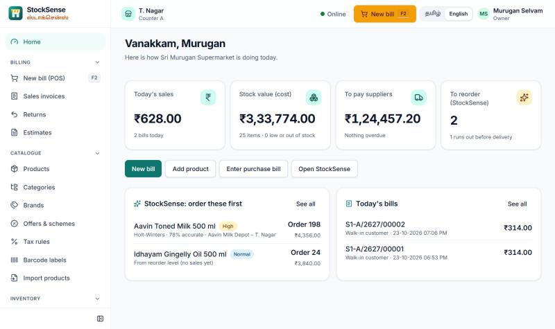
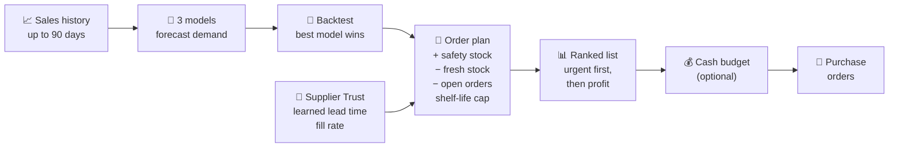
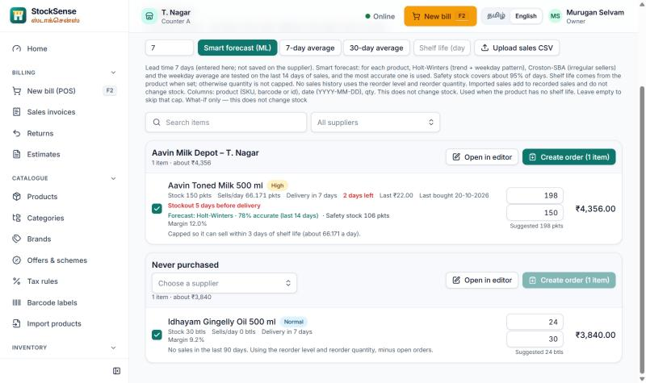
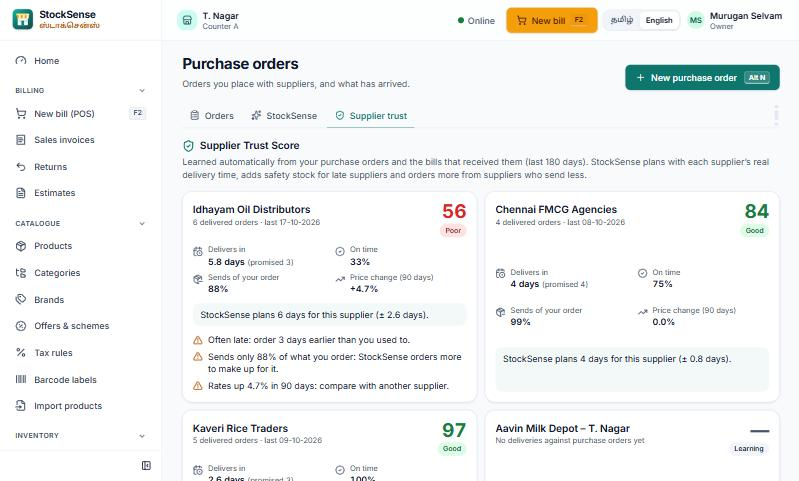
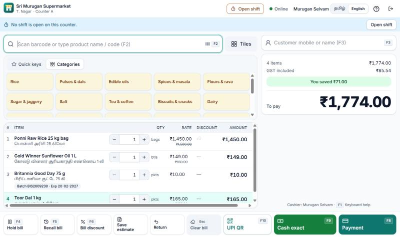
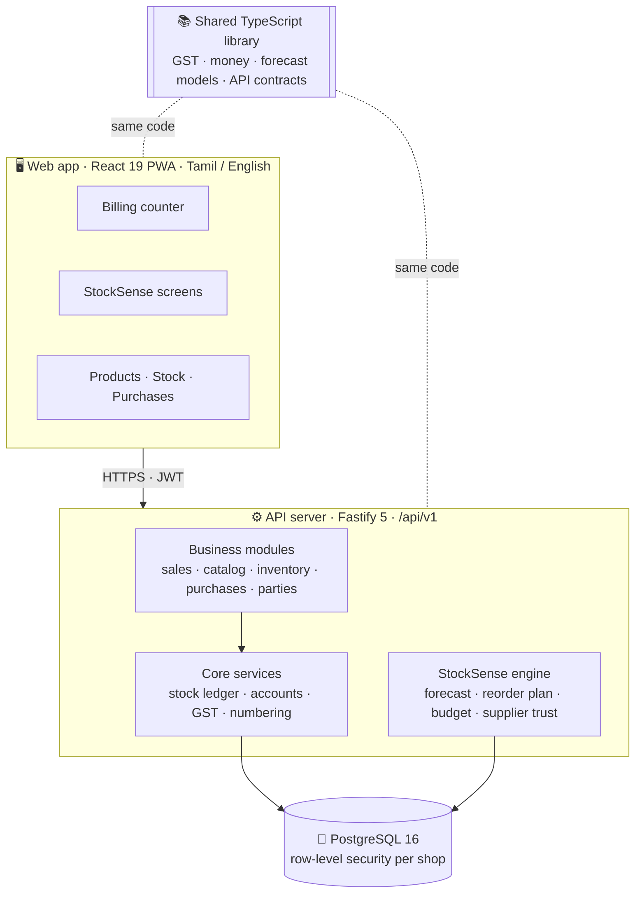

<div align="center">

# 📦 StockSense
### Smart reorder planning for small retail shops

**What to buy · How much · What first**

*Built by **Team Synergy Labs** for **KSR Quantix Hackathon 2K26***


</div>

<p align="center">
  
</p>

---

## 📑 Contents

- [The problem](#-the-problem)
- [Our solution](#-our-solution)
- [Key features](#-key-features)
- [How StockSense decides](#-how-stocksense-decides)
- [The ML engine](#-the-ml-engine)
- [Unique feature 1: Cash budget order](#-unique-feature-1-cash-budget-order)
- [Unique feature 2: Supplier Trust Score](#-unique-feature-2-supplier-trust-score)
- [Worked example](#-worked-example-aavin-toned-milk)
- [Screenshots](#-screenshots)
- [Tech stack](#-tech-stack)
- [Architecture](#-architecture)
- [Getting started](#-getting-started)
- [Demo login](#-demo-login)
- [Project structure](#-project-structure)
- [Testing](#-testing)
- [Project status](#-project-status)
- [Roadmap](#-roadmap)
- [Team](#-team-synergy-labs)

---

## 🎯 The problem

Small store owners order from memory. Three things go wrong every week:

| | Problem | Result |
|---|---|---|
| 🔴 | **Fast movers run out** | Milk, rice and oil sell out before the next delivery, and customers go to another shop |
| 🟠 | **Slow items lock up cash** | Items that rarely sell are reordered anyway and sit on the shelf for weeks |
| 🟡 | **Short-dated stock expires** | Ordering too much milk, bread or curd means throwing it away |

Behind all three is one more problem: **suppliers are unreliable**. They deliver late, send less than ordered, and change their rates, so even a good order plan fails.

## 💡 Our solution

**StockSense** forecasts demand for every product and produces a **ranked reorder list with exact quantities**, respecting **supplier lead time** and **shelf life**.

```
 The owner gives                         StockSense returns
 ─────────────────                       ──────────────────────────────────────
 • Past sales (billing counter or CSV)   • A ranked order list
 • Stock on hand (updated by every bill) • The exact quantity for every item
 • Supplier lead time (learned)          • Most urgent and most profitable first
 • Shelf life of each product            • A plain-English reason on every row
```

StockSense is built into a **complete shop app**: GST billing, products, stock, purchases and suppliers, in **Tamil and English**. Every bill at the counter updates stock and becomes sales history for StockSense automatically, so the owner never enters data twice.

## ✨ Key features

### StockSense: smart reorder
| Feature | What it does |
|---|---|
| 🧠 **Smart forecast (ML)** | Holt-Winters, Croston-SBA and a weekday average compete for every product |
| 🎯 **Backtest accuracy** | The best model is picked on the last 14 days of real sales, and its accuracy is shown on every row |
| 🛡️ **Safety stock** | A buffer sized by how unpredictable an item is **and** how late its supplier is |
| 🥛 **Shelf-life cap** | Never orders more than can sell before it expires |
| 📊 **Ranked list** | Urgent → High → Normal, then days short, then profit margin |
| 🔢 **Exact quantities** | Rounded to the pack size, minus what is already on order |
| 💰 **Cash budget order** | Spends the cash the owner has today on the items that matter most |
| 🤝 **Supplier Trust Score** | Learns each supplier's real delivery time, on-time rate, fill rate and price changes |
| 📝 **One-click purchase orders** | Turns the list into supplier orders in one step |
| 📤 **Sales history import** | Upload past sales as CSV |

### Shop app
| Area | Features |
|---|---|
| 🏠 **Home dashboard** | Today's sales, stock value, supplier dues, top items to reorder |
| 🧾 **Billing counter** | Barcode scan, name search, automatic GST, cash payment with change, receipt print |
| 📦 **Products** | Prices, MRP, HSN codes with suggested GST, barcodes, categories, brands, labels |
| 🏬 **Inventory** | Stock levels and value, batches and expiry, stock counts, movements, transfers |
| 🚚 **Purchases** | Purchase orders, purchase bills (stock in), returns to suppliers |
| 👥 **Parties** | Suppliers with dues, customers and khata (credit) balances |
| 🌐 **Bilingual** | The full interface in Tamil and English |

## ⚙️ How StockSense decides



1. **Collect:** up to 90 days of daily sales per product, from the billing counter and CSV imports.
2. **Forecast:** three models each predict demand until the next delivery.
3. **Backtest:** the last 14 days are hidden, each model predicts them, and the one with the lowest error wins for that product.
4. **Plan:** forecast + safety stock − stock still fresh at delivery − open orders, raised for short-supplying suppliers, capped by shelf life and rounded to the pack.
5. **Rank:** by priority, then days of shortage, then profit margin.

## 🧠 The ML engine

For **every product**, three time-series models compete:

| Model | Best for | How it learns |
|---|---|---|
| **Holt-Winters** (damped trend, weekly season) | Daily sellers | Learns level, trend and the weekday pattern; smoothing constants are fitted from the shop's own data |
| **Croston-SBA** | Irregular sellers | Learns how much sells when it sells, and how often (Syntetos–Boylan bias correction) |
| **Weekday average** | Baseline | Average of the same weekday over four weeks; the model the others must beat |

**Backtest.** We hide the last 14 days, let each model predict them, and score them with **WAPE** (weighted absolute percentage error). The lowest error wins for that product, and the screen shows the result, e.g. *"Holt-Winters · 78% accurate (last 14 days)"*.

**Safety stock.** It covers both demand error and late deliveries, at about a **95% service level**:

$$\text{Safety stock} = 1.645 \times \sqrt{L \cdot \sigma_d^2 + \bar{d}^2 \cdot \sigma_L^2}$$

*L = lead time, σ<sub>d</sub> = daily forecast error, d̄ = daily demand, σ<sub>L</sub> = spread of the supplier's lead time.*

**Why classical models instead of deep learning?** Small shops have weeks of data, not years. These models work with little data, run in milliseconds on a shop PC with no GPU, and **every number can be explained** to the owner. They are written in TypeScript with no ML library, so the same code runs in the browser and on the server.

## 💰 Unique feature 1: Cash budget order

> *Other apps tell the owner what is low. StockSense also tells them what to buy with the money they actually have today.*

The owner types the cash available today, for example ₹10,000, and StockSense:

1. buys the **must-haves** first: what would run out before the delivery, in priority order;
2. spends what is left on **safety stock**;
3. cuts to **whole packs**, includes **GST**, and never goes over the budget;
4. shows **how much of the must-have need** the budget covers and **what is left out**.

Every row is labelled **Fits budget**, **Must-have only**, **Cut to fit** or **Left out**, and the purchase orders follow the budget.

## 🤝 Unique feature 2: Supplier Trust Score

> *Forecasting demand is only half the problem. StockSense also forecasts the supplier.*

StockSense learns each supplier's real behaviour from purchase orders and the bills that received them, with no setup:

| Metric | Learned from |
|---|---|
| ⏱️ Real delivery time | Order date → date the goods arrived |
| ✅ On-time rate | Delivered on or before the expected date |
| 📦 Fill rate | Quantity received ÷ quantity ordered |
| 💹 Price change | Supplier rates over the last 90 days |

**Trust score (0–100)** = 50% on-time + 35% fill rate + 15% consistency. Suppliers with fewer than 3 delivered orders are shown as *Learning*.

StockSense then uses the learned values:
- **Each supplier's own lead time** instead of one number for everyone;
- **more safety stock** for late, unpredictable suppliers;
- **bigger orders** from suppliers who send less than ordered;
- **alerts:** *"Often late: order 3 days earlier"*, *"Sends only 88% of what you order"*, *"Rates up 4.7% in 90 days"*.

## 🥛 Worked example: Aavin Toned Milk

| Input | Value |
|---|---|
| Sales per day (Holt-Winters, 78% accurate) | ~66 packets |
| Stock on hand | 150, but they expire before the delivery |
| Days until delivery | 7 |
| Shelf life | 3 days |

```
Need            = forecast 463 + safety stock 106 = 569 packets
Shelf-life cap  = 3 days × 66 per day           = 198 packets
Order           = 198 packets · High priority (runs out 5 days before delivery)
```

Ordering 569 would have wasted most of the milk. StockSense orders **198**.

> Numbers from the demo shop, which uses generated sample sales data.

## 📸 Screenshots

| Home dashboard | StockSense reorder list |
|---|---|
|  |  |
| **Supplier Trust Score** | **Billing counter** |
|  |  |

## 🛠️ Tech stack

| Layer | Technologies |
|---|---|
| **Frontend** | React 19 · TypeScript 5.9 · Vite 7 · Tailwind CSS 4 · TanStack Query 5 · React Router 7 · i18next (Tamil + English) · PWA + Dexie (offline) |
| **Backend** | Node.js · Fastify 5 · Zod 4 (API contracts) · Kysely (type-safe SQL) · pg-boss (jobs) · JWT (jose) + Argon2 · Pino |
| **Data & ML** | PostgreSQL 16 with row-level security · Holt-Winters · Croston-SBA · WAPE backtest · safety-stock model · budget planner · supplier scoring |
| **DevOps & quality** | pnpm monorepo · Vitest · Playwright · Docker · Kubernetes · GitHub Actions · Prometheus metrics |

**One TypeScript codebase end to end.** The GST engine, money rounding and the StockSense forecast live in a shared library, used by both the browser and the server.

## 🏗️ Architecture



- **Correct money:** amounts are integer paise and quantities are integer milli-units, so there are no rounding errors. Every bill posts stock movements and a balanced journal in one transaction.
- **Each shop's data is isolated** by PostgreSQL row-level security.
- **One codebase, two ways:** cloud for many shops, or a single shop PC.

## 🚀 Getting started

**Prerequisites:** Node.js 22+, pnpm 10, PostgreSQL 16.

**1. Create the database roles** (once, as a PostgreSQL superuser):

```sql
CREATE ROLE kadai_owner LOGIN CREATEDB PASSWORD 'kadai_owner';
CREATE ROLE kadai_app   LOGIN PASSWORD 'kadai_app';
CREATE DATABASE kadai OWNER kadai_owner;
\c kadai
CREATE EXTENSION IF NOT EXISTS pg_trgm;
CREATE EXTENSION IF NOT EXISTS citext;
```

**2. Install, configure and migrate:**

```bash
pnpm install
cp .env.example .env
pnpm db:migrate
```

**3. Load the demo shop** (optional, recommended):

```bash
cd apps/server
pnpm exec tsx scripts/seed-demo.ts
pnpm exec tsx scripts/seed-supplier-history.ts
cd ../..
```

**4. Run:**

```bash
pnpm dev
```

Open **http://localhost:5173**. The API runs on port 8080, and the API docs are at http://localhost:8080/api/docs.

**Single-process run** (the built web app served by the API):

```bash
pnpm build
node apps/server/dist/server.js
```

Then open **http://localhost:8080**.

> `.env.example` contains no secrets. In development, empty `JWT_SECRET` and encryption keys fall back to built-in development values; production refuses to start without real ones.

## 🔑 Demo login

| | |
|---|---|
| **Mobile** | `9000000001` |
| **Password** | `KadaiDemo@2026` |
| **Shop** | Sri Murugan Supermarket, T. Nagar, Chennai (demo data) |

**Suggested demo path:** Home → New bill (sell two items) → Purchases → Purchase orders → **StockSense** tab (smart forecast + cash budget) → **Supplier trust** tab.

## 📁 Project structure

```
.
├─ apps/
│  ├─ server/                 Fastify API, worker and SQL migrations
│  │  ├─ migrations/          versioned SQL migrations
│  │  ├─ scripts/             demo data: seed-demo.ts, seed-supplier-history.ts
│  │  └─ src/modules/
│  │     └─ purchases/        StockSense: reorder.ts, supplier-trust.ts
│  └─ web/                    React 19 PWA
│     └─ src/features/
│        ├─ dashboard/        Home dashboard
│        ├─ pos/              Billing counter
│        └─ purchases/        StockSense, Supplier trust, purchase orders and bills
├─ packages/
│  └─ shared/                 shared TypeScript library
│     └─ src/
│        ├─ forecast.ts       Holt-Winters, Croston-SBA, backtest, safety stock
│        ├─ budget.ts         cash budget planner
│        └─ supplier-trust.ts supplier scoring and learned lead times
├─ deploy/                    Docker, cloud compose, Kubernetes, on-prem kits
└─ docs/                      architecture, API, deployment, screenshots
```

## 🧪 Testing

```bash
cd packages/shared && pnpm test     # forecast, budget, supplier trust, GST, money: 2,000+ tests
pnpm typecheck                      # strict TypeScript across all packages
```

The StockSense engines have their own unit tests: `forecast.test.ts`, `budget.test.ts` and `supplier-trust.test.ts` in `packages/shared/test/`.

## 📋 Project status

| Status | Area |
|---|---|
| ✅ Working | StockSense (smart forecast, backtest, safety stock, shelf-life cap, ranking, cash budget, Supplier Trust Score), Home dashboard, billing counter, sales invoices, products, stock, purchases, suppliers, customers and khata, settings, Tamil and English |
| 🚧 In progress | Cash shifts, UPI payments, accounting, reports and GST returns, WhatsApp and SMS notifications |

## 🗺️ Roadmap

- 📅 **Festival uplift:** boost the forecast before Pongal, Deepavali and Aadi
- 💸 **Lost Sales Radar:** estimate the sales lost on days an item ran out, and correct the forecast
- 📲 **WhatsApp orders:** send purchase orders to suppliers in one tap
- 🧯 **Overstock alerts:** flag slow movers that lock up cash
- 💳 **UPI and accounts:** finish payments, shifts and GST reports

## 👥 Team Synergy Labs

| Role | Name |
|---|---|
| 👑 **Team Leader** | **Prathip M** |
| 👩‍💻 Member | Sujitha S |
| 👩‍💻 Member | Vijayavani K |
| 👨‍💻 Member | Abishek A S |

<div align="center">

**Built with ❤️ for small shops · KSR Quantix Hackathon 2K26**

</div>
